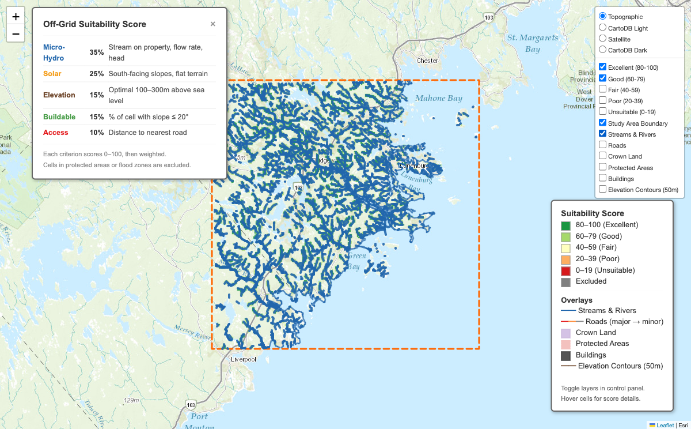
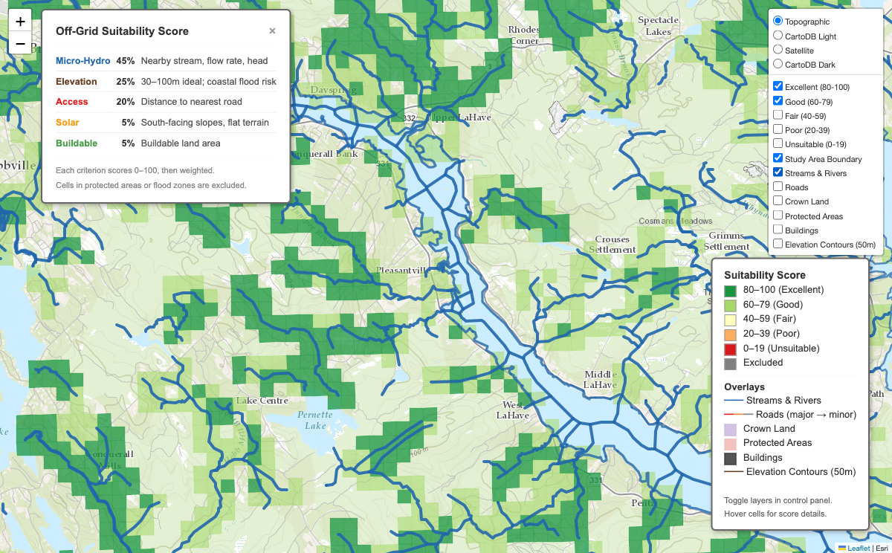

# Off-Grid Property Finder

Rank Nova Scotia land for off-grid living suitability using geospatial analysis.

Generates a 250m candidate grid over a configurable study area, scores each cell across five criteria (micro-hydro potential, road access, open ground for solar/building, wind resource, and coastal-flood-safe elevation), and produces ranked output as CSV, GeoJSON, and an interactive Folium map.

Built for screening rural Nova Scotia land — particularly the south shore near Lunenburg — for residential off-grid potential with an emphasis on micro-hydro power.





## How It Works

```
Raw GIS Data → Ingest & Reproject → DEM Derivatives → Masks → 250m Grid
    → Score (5 criteria) → Exclusions → Confidence → Rank → Export + Map
```

1. **Ingest** raw data (DEM, streams, roads, land cover, buildings) into standardized formats
2. **Prepare** DEM derivatives (slope, aspect, flow accumulation) and build eligibility masks
3. **Score** each 250m cell on five weighted criteria
4. **Exclude** cells in protected areas or flood zones, and cells that are mostly water
5. **Export** ranked results as CSV, GeoJSON, GeoPackage, and an interactive HTML map

## Quick Start

```sh
# Create venv and install
python3.12 -m venv .venv
source .venv/bin/activate
pip install -e ".[dev]"
# or, for the exact versions CI tests against:
#   pip install -r requirements-lock.txt && pip install -e . --no-deps

# Place raw GIS data in data/raw/ (see Data section below)

# Run the pipeline
python -m src prepare        # Ingest, clip, generate DEM derivatives, build grid
python -m src ingest-parcels # (optional) ingest NSPRD parcels for PID output — Stage B
python -m src score          # Score cells, compute confidence, rank, export (+ ranked PIDs)
python -m src visualize      # Generate interactive map
```

## Scoring Criteria

Each eligible cell receives a weighted composite score (0-100):

| Criterion | Weight | What it measures |
|-----------|--------|------------------|
| **Hydro** | 40% | Micro-hydro power potential from mapped streams within 100 m (head x low flow x efficiency). Head comes from SPEC §3.1 intake/outfall pairs 50–500 m apart down the stream, with at least 3 m of fall. Flow is read at the intake from a validated flow-accumulation raster, routed on land with the sea as the outlet (else a segment-length proxy). Coastline and tidal lines don't count as streams. |
| **Access** | 20% | Distance from the cell to the nearest road or civic address (not legal access); "within 50/200/500 m" is measured from the cell's edge, inclusive |
| **Open ground** | 15% | Flat, open, unbuilt, non-water land area — ground-mount solar room + building pad (small bonus when a quarter of that open ground faces south; none for a cell with no open ground) |
| **Wind** | 15% | Estimated mean wind speed at a small off-grid turbine's hub height (default 30 m, `wind.hub_height_m`), extrapolated down from the Global Wind Atlas 50 m and 100 m layers with a per-pixel power-law shear fit (GWA's 10 m layer sits inside the forest canopy and isn't used). Bands: ≥6.0 m/s 100, 5.0–6.0 85, 4.5–5.0 65, 4.0–4.5 40, <4.0 15. Falls back to terrain exposure (TPI ridge/hilltop) as a proxy if GWA is unreachable. |
| **Elevation** | 10% | Coastal-flood penalty only — low/at-risk coastal land scores low; high, exposed ground is *not* penalized. Uses the mean of the cell's land pixels, so sea in a shore cell doesn't pull it down |

Hydro dominates because it's the scarce, hard-to-replicate differentiator and the best winter generator — solar works almost everywhere in NS, so it's a weak land-selection signal. Weights are configurable in `config.yaml` and auto-renormalize when criteria are disabled. The older `solar` and `buildable` criteria remain registered (and unit-tested) but are off by default — they were near-constant in NS and are superseded by `open_ground`.

### Composite vs. all-rounder

Each cell gets two scores: the weighted **composite** `score` (compensatory — a strong hydro site can rank high on its own), and `score_allrounder`, a weighted **geometric mean** of the sub-scores. The all-rounder drops sharply if *any* criterion is weak, so it surfaces true do-it-all "perfect candidate" parcels rather than one-trick sites. A `wind_worth_it` flag marks cells with real wind resource *and* limited room for more solar.

### Hard Exclusions

Cells are excluded (`score = null`) when:
- Centroid falls inside a mapped protected area or flood zone, **or**
- Protected, flood and water polygons together cover at least 50% of the cell (configurable; area under more than one layer counts once)
- Water (`data/processed/waterbodies.gpkg`: lakes, rivers and the sea) counts by overlap only, so a pond or lake edge over a mostly-land cell's centroid doesn't exclude it. The layer is optional and skipped if missing.
- Parcels get cells by centroid containment, except that a mostly-land shore cell whose centroid is in water goes to the parcel holding most of its land, not to a water lot.
- A parcel's size score and the 40-acre severance rule use its land acres (`land_acres`): its acreage less any of that water inside it, so a water lot or a lakefront lot drawn out into the lake doesn't rank as a big parcel. `area_acres` (the whole mapped area) is still exported next to it.
- A parcel with less land than `min_parcel_area_acres` (default 1 acre) gets no score or rank and is flagged `parcel_below_min_area` (SPEC §2.1).
- NSPRD polygons that are not property — road rights-of-way and water lots (their `ROADWAT` code) and placeholder PIDs such as `00000006` — are never ranked or made severance candidates, and are flagged `parcel_not_property`.
- `area_acres` is the whole parcel, measured before the clip to the study area; for a parcel cut by the study-area edge, `land_acres` is an estimate (its water share is measured on the part inside).

Excluded cells are still emitted in output with `status = excluded` and explicit `exclusion_reasons` (always in the order `protected_area; flood_zone; water`, so the strings group cleanly).

### Confidence Scoring

Each cell gets a confidence score (0-100) and band (high/medium/low). Starts at 100, with deductions for:
- Missing flood data (-20)
- Hydro uses drainage proxy only (-20)
- DEM is 20m resolution, not LiDAR (-15)
- Incomplete land-cover mask (-10)
- No road evidence within 200m (-15)
- Wind from terrain exposure only, not a wind raster (-10)

Amounts come from `confidence_deductions` in `config.yaml`. Parcels carry the lowest confidence of the cells their score rests on.

## CLI Commands

```sh
python -m src --help            # Show all commands
python -m src check-data        # Verify raw data files are present and readable
python -m src ingest            # Convert raw -> processed formats
python -m src ingest-parcels    # Ingest NSPRD parcels with PID (add --from-rest to pull from the NSPRD service)
python -m src prepare           # Full data preparation pipeline
python -m src score             # Score, rank, and export results (+ ranked PIDs if parcels present)
python -m src visualize         # Generate interactive Folium map
python -m src snapshot          # Rebuild the committed results/ snapshot from output/ranked_parcels.csv
python -m src analyze           # Print score distribution statistics
```

Options: `--config path/to/config.yaml`, `--log-level DEBUG|INFO|WARNING|ERROR`

## Configuration

Edit `config.yaml` to customize:

- **study_area**: `bbox: [xmin, ymin, xmax, ymax]` in the working CRS's metres (xmin < xmax, ymin < ymax; a lon/lat box is rejected) and a `name` (a label only)
- **working_crs**: A projected CRS in metres (default `EPSG:2961`)
- **cell_size_m**: Grid cell size, a whole number of metres > 0 (default: 250)
- **paths**: `raw`, `processed`, `output` folders
- **weights**: Per criterion (`hydro`, `access`, `open_ground`, `wind`, `elevation`, `solar`, `buildable`), each ≥ 0; the enabled ones are renormalised to 100 and must sum to more than 0
- **enabled_criteria**: Which of those names to score (default: every weighted criterion)
- **confidence_deductions**: Penalty per data-quality gap; a partial block is merged over the defaults; amounts ≥ 0
- **exclusion_overlap_threshold**: Fraction of a cell's area, in (0, 1], that triggers exclusion (default: 0.5; a fraction, not a percent)
- **min_parcel_area_acres**: Parcels with less land than this are unranked (default: 1; 0 turns it off)
- **preferences.parcel_aggregation**: `top_n` (≥ 1, default 3) and `cell_weight` (in [0, 1], default 0.65) for the parcel score
- **wind**: `hub_height_m` and `gwa_layers` (see DATA-SOURCES §3.3)

Unknown keys (e.g. a misspelt `weight:`), empty blocks and an empty file are errors, so a typo can't silently fall back to a default. An empty `preferences:` or `wind:` means the defaults.

## Data

Place raw data in `data/raw/` subdirectories:

| Directory | Dataset | Source | Required? |
|-----------|---------|--------|-----------|
| `dem/` | DEM raster(s) (GeoTIFF; every tile is mosaicked, HRDEM gaps filled from CDEM, with a warning if the study area isn't covered) | [CDEM](https://ftp.maps.canada.ca/pub/nrcan_rncan/elevation/cdem_mnec/) or [HRDEM](https://open.canada.ca/data/en/dataset/957782bf-847c-4644-a757-e383c0057995) | Yes |
| `hydro/` | Stream network (GDB/Shapefile) | [NSHN](https://data.novascotia.ca/datasets/dk27-q8k2) | Yes |
| `roads/` | Road network (OSM PBF) | [Geofabrik](https://download.geofabrik.de/north-america/canada/nova-scotia-latest.osm.pbf) | Yes |
| `buildings/` | Building footprints (GPKG) | [NRCan](https://open.canada.ca/data/en/dataset/7a5cda52-c7df-427f-9ced-26f19a8a64d6) | Yes |
| `land-cover/` | Land cover polygons (Shapefile) | [NSTDB](https://nsgi.novascotia.ca/WSF_DDS/DDS.svc/DownloadFile?tkey=fhrTtdnDvfytwLz6&id=13) | Yes |
| `exclusions/protected_areas/` | Protected areas (every file in it is read; flood zones are fetched from the NS Coastal Program, not read from here) | [GeoNova](https://geonova.novascotia.ca/geodata/) | Recommended |
| `civic/` | Civic address points (any vector format; every file is read) | NS civic addressing | Optional |
| `crown-land/` | Crown land parcels (Shapefile) | [NS Open Data](https://data.novascotia.ca/Lands-Forests-and-Wildlife/Crown-Land/3nka-59nz) | Optional |
| `parcels/` | Property parcels with PID (NSPRD) | `ingest-parcels --from-rest` (free, public — see DATA-SOURCES §5.1) or [GeoNOVA](https://geonova.novascotia.ca/nova-scotia-property-records-parcels) (fee/restricted bulk download); for a few parcels use ViewPoint/PVSC lookups | Stage B (PIDs) |

Layers that can be tiled or split (DEM tiles, buildings, parcels, waterbodies, civic, protected areas, NSTDB POLY sheets) read every matching file. Layers where only one file can be right (streams, roads, other land-cover files, Crown land) stop with an "ambiguous" error if several are present. `check-data` uses the same rules, so it reports what `ingest` will actually read.

Neither `data/raw/` nor `data/processed/` is committed to the repo (both are gitignored) — a fresh clone must run `prepare` before scoring. Flood (NS Coastal Program) and wind (Global Wind Atlas) need no raw download at all: `prepare`/`ingest` fetch them directly into `data/processed/` from public services. To re-ingest from scratch (e.g., to change the study area), delete `data/processed/`, place the raw files above in `data/raw/`, and run `python -m src prepare`.

**Changing the study area or cell size:** `prepare`/`ingest` record the config values (`study_area`, `cell_size_m`, `working_crs`) that produced `data/processed/` in a small manifest. If you change those in `config.yaml`, the next `prepare`/`ingest`/`score` run will refuse to proceed (rather than silently mixing old- and new-region outputs) unless you pass `--force`, which clears the generated outputs and rebuilds them for the new config. A pre-existing `data/processed/` with no manifest yet is treated as unknown, not stale — it's baselined against the current config, not deleted. The manifest also records what `wind.tif` was built from (GWA layer URLs, hub height, ingest method): changing `wind:` in `config.yaml` makes `score` refuse the stale raster (exit code 1), and `ingest --force` then rebuilds only `wind.tif` (a few seconds), leaving the DEM derivatives and parcels alone. The rebuild goes to a temp file that replaces `wind.tif` only once complete, so a failed fetch keeps the previous file. A `wind.tif` with no such record (built before 2026-11-06, i.e. the old 100 m layer) counts as stale.

See [DATA-SOURCES.md](DATA-SOURCES.md) for the full data source inventory.

### Format Conversion

The `ingest` command handles format conversion automatically:
- OSM PBF -> filtered road GPKG
- NSHN File Geodatabase -> stream line GPKG
- DEM reprojection (any CRS -> EPSG:2961) and clipping
- Compound CRS handling (NAD83(CSRS)v6 + CGVD2013)

## Output

All output goes to `output/`:

| File | Description |
|------|-------------|
| `scored_cells.gpkg` | Full results with geometry (GeoPackage) |
| `scored_cells.csv` | All cells with lat/lon, scores, confidence |
| `scored_cells.geojson` | GeoJSON in WGS84 for web mapping |
| `ranked_eligible.csv` | Eligible cells only, sorted by rank |
| `ranked_parcels.csv` | **PID candidate list** — scored parcels sorted best-first, ties by PID (Stage B; only when parcel data is present). Includes each parcel's `confidence`, `confidence_band`, the flags of the cells its score rests on, and `top_<criterion>` means of those cells, which rebuild `cell_score` |
| `scored_parcels.gpkg` / `.geojson` | Parcels with aggregated scores and geometry (Stage B) |
| `map.html` | Interactive Folium map with color-coded cells (+ a "Scored Parcels (PID)" layer when available) |

Each cell record includes `cell_id` (first column, joins the CSVs to the GPKG), `score`, `status`, `exclusion_reasons`, `confidence`, `confidence_band`, and `flags`. When nothing ranks, the ranked CSVs are written with a header only, and a run without parcels removes the previous run's parcel outputs, so `output/` never mixes runs. `score`, `visualize` and `ingest-parcels` exit 1 when they can't produce their output (stale or missing processed data, a failing scorer, no parcels).

## Project Structure

```
src/
├── cli.py              # Click CLI with subcommands
├── config.py           # YAML config loading and validation
├── constants.py        # Threshold tables, weights, flags
├── ingest.py           # Raw data ingestion (format conversion)
├── prepare.py          # Data preparation orchestrator
├── score.py            # Scoring pipeline orchestrator
├── export.py           # CSV/GeoJSON export
├── visualize.py        # Folium map generation
├── grid.py             # Candidate grid generation
├── dem.py              # DEM derivative generation (slope, aspect, flow)
├── mask.py             # Rural-eligibility and buildability masks
├── exclusions.py       # Exclusion layer loading and application
├── clip.py             # Raster/vector clipping
├── crs.py              # CRS utilities
├── check_data.py       # Data validation
├── analyze.py          # Score distribution analysis
├── logging_config.py   # Logging setup
└── scoring/            # Pluggable scorer registry
    ├── registry.py     # Scorer registration + weighted composite
    ├── hydro.py        # Micro-hydro power estimation
    ├── solar.py        # Solar suitability scoring
    ├── elevation.py    # Elevation scoring
    ├── access.py       # Road/civic address proximity
    ├── buildable.py    # Buildable area percentage
    ├── confidence.py   # Confidence scoring and banding
    └── preferences.py  # Parcel aggregation (Stage B)
tests/
├── conftest.py         # Synthetic test fixtures
├── test_config.py      # Config loading and validation
├── test_cli.py         # CLI command tests
├── test_grid.py        # Grid generation and filtering
├── test_exclusions.py  # Exclusion logic
├── test_export.py      # CSV/GeoJSON export
├── test_scoring_*.py   # Per-scorer unit tests (7 files)
├── test_analyze.py     # Score distribution analysis tests
└── test_integration.py # End-to-end pipeline test
```

## Development

```sh
source .venv/bin/activate
pytest                    # Run the test suite
pytest -v                 # Verbose output
pytest tests/test_grid.py # Run specific test file
```

## Technical Details

- **CRS**: All processing uses EPSG:2961 (NAD83(CSRS) UTM Zone 20N). Raw data in other CRS is automatically reprojected during ingestion.
- **Grid**: Fixed 250m x 250m square cells. Cells are filtered by rural-eligibility mask but never clipped — they remain fixed squares.
- **Hydro methodology**: Based on Cyr et al. (2011) methodology for NB small hydro assessment. Uses conservative low-flow proxy (8 L/s/km2) calibrated from HYDAT station data for southern NS.
- **Raster compression**: All processed rasters use LZW compression (lossless) to minimize disk usage.
- **Stack**: Python 3.12, GeoPandas, Rasterio, WhiteboxTools, Shapely, Folium, Click

## Roadmap

- **Stage A**: Candidate-cell scoring MVP — complete and functional
- **Stage B (implemented)**: Parcel-aware pipeline — joins cell scores to authoritative NSPRD parcels and emits a **PID-ranked candidate list** (`ranked_parcels.csv`). Drop NSPRD parcels into `data/raw/parcels/` (or run `ingest-parcels --from-rest`), then `score`.
- **Calibration**: Validate scores against known sites, tune thresholds
- **Future**: HYDAT-based flow regression, LiDAR refinement, web dashboard, multi-province support

## Documentation

- [SPEC.md](SPEC.md) — Full technical specification, scoring methodology, and risk register
- [DATA-SOURCES.md](DATA-SOURCES.md) — Complete data source inventory with URLs
- [IMPLEMENTATION-BACKLOG.md](IMPLEMENTATION-BACKLOG.md) — Task breakdown and milestone plan
- [docs/seasonal-energy-balance.md](docs/seasonal-energy-balance.md) — How hydro/solar/wind complement each other across the year (HYDAT + NASA POWER data)

## License

[MIT](LICENSE)

## References

- Cyr, J.-F., Landry, M., & Gagnon, Y. (2011). Methodology for the large-scale assessment of small hydroelectric potential: Application to the Province of New Brunswick (Canada). *Renewable Energy*, 36(11), 2940-2950.
